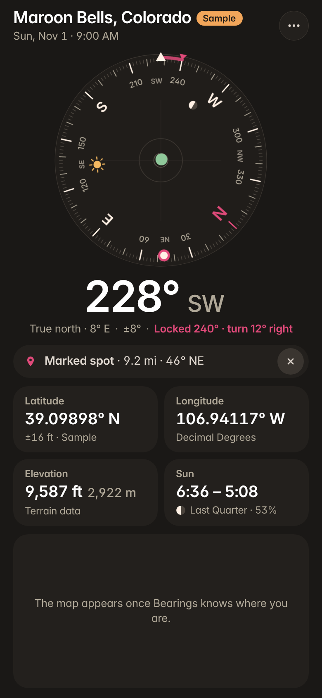

<p align="center"></p>

<h1 align="center">Bearings</h1>
<p align="center"><b>Get your bearings.</b><br>
The compass, where you are, the time, your coordinates and elevation, the sun and moon, and a map, on one screen.<br>
Free and open source for iPhone, iPad, Mac, Android and the web, with widgets. No ads, no account, no tracking.<br>
Made by <a href="https://bradcowdrey.com">Bradley Cowdrey · bradcowdrey.com</a></p>

<p align="center">
  <a href="https://bradcowdrey.com/bearings"><b>Try it in your browser</b></a> ·
  <a href="https://github.com/bradleycowdrey/bearings/releases/latest/download/Bearings.apk"><b>Android APK</b></a> ·
  <a href="https://github.com/bradleycowdrey/bearings/releases/latest/download/Bearings.dmg"><b>Download for Mac</b></a> ·
  <a href="CHANGELOG.md">What's new</a> ·
  <a href="https://github.com/bradleycowdrey/bearings/issues">Report an issue</a>
</p>

<p align="center">
  <a href="https://bradcowdrey.com/bearings"></a>
</p>

---

Everything you'd want from a compass app, on one screen: which way you're facing, where you are and
when, exactly where on the map, how high you are, and where the sun and moon are.

## Features

The ten things people use most in the leading compass and altimeter apps (see [docs/RESEARCH.md](docs/RESEARCH.md)),
all in Bearings, laid out in [docs/DESIGN.md](docs/DESIGN.md):

1. **A clear compass**: 228° SW under a fixed line, true or magnetic north with the declination, smooth,
   turning the short way past north, with a light tick at N, E, S and W.
2. **Where and when**: the town you're in ("Aspen, Colorado"), or how far you are from the nearest one,
   with the date and time.
3. **Six coordinate formats**: decimal degrees, DMS, decimal minutes, UTM, MGRS and Plus Codes. Tap to
   switch; hold to copy; share your location.
4. **Elevation in feet and metres at once**, from GPS when it's accurate (sea level on Android 14+ too),
   otherwise terrain data; with air pressure where there's a barometer.
5. **The sun and moon on the dial**, with sunrise, sunset and the moon's phase.
6. **Mark a spot, find it again**: its direction on the dial and its distance.
7. **Lock a bearing** and see how far you've turned from it.
8. **A bubble level** in the middle of the dial.
9. **A map** with your heading, north up or following you; satellite on Apple devices.
10. **Honest accuracy**: ± for position and heading, a figure-8 hint only when needed, a warning near
    magnets and metal, and your speed as you move.

Plus **night mode** (all red, to keep your night vision), **widgets** (iPhone and iPad Home Screen and Lock
Screen, Mac desktop, Android Home Screen), and it works **offline** except for the map and terrain elevation.

Before building it, we looked at the most-used compass apps and the open-source ones: see
[docs/RESEARCH.md](docs/RESEARCH.md) for what Bearings borrows and what it avoids.

## Privacy

Your location stays on your device. Bearings sends only a position rounded to about 100 m to
[Open-Meteo](https://open-meteo.com) to look up the ground elevation, and loads map tiles for where you
are (Apple Maps, or OpenFreeMap on Android and the web). The place's name comes from your device's own
geocoder, or from a list of towns built into the app ([GeoNames](https://www.geonames.org)); the web
version uses only the built-in list. No analytics, no account. The full
[Terms of Use and Privacy](https://bradcowdrey.com/legal) cover every Bradley Cowdrey app.

## How it's built

| | |
|---|---|
| iPhone, iPad, Mac | SwiftUI (`Sources/`), one screen shared by all three; CoreLocation for position and heading (true north from iOS), CoreMotion for the level, MapKit for the map. `project.yml` (XcodeGen) builds both apps. |
| Android | Kotlin and Jetpack Compose (`android/`); Android's own LocationManager (no Google Play services), the rotation-vector sensor remapped to the screen, `GeomagneticField` for true north, `AltitudeConverter` for sea-level GPS heights, MapLibre for the map. |
| Web | `web/app.html` and `web/core.js`, built into `docs/` (GitHub Pages) by `scripts/build-web.sh`. Device orientation events, the Geolocation API, MapLibre GL JS. |

The coordinate maths is written three times (`web/core.js`, `Sources/Bearings/Core/Geo.swift`,
`android/.../Core.kt`) and all three are tested against the same expected values,
[`Tests/fixtures/geo.json`](Tests/fixtures/geo.json), which `scripts/make-fixtures.js` makes from the web core
after checking it against [proj4](https://github.com/proj4js/proj4js), [mgrs](https://github.com/proj4js/mgrs)
and [open-location-code](https://github.com/google/open-location-code) at 500 random places.

## Build from source

```sh
git clone https://github.com/bradleycowdrey/bearings.git
cd bearings
swift test                          # the core's unit tests (macOS)
swift run Bearings                 # the Mac app, in development
scripts/build-app.sh 1.18.0         # dist/Bearings.app (needs XcodeGen: brew install xcodegen)
scripts/build-ios.sh 1.18.0         # the iPhone and iPad app for the Simulator
scripts/build-web.sh                # docs/app.html and docs/index.html
node tests/web.test.js              # the web tests (npm install playwright)
cd android && ./gradlew assembleDebug testDebugUnitTest   # Android (JDK 17 and the Android SDK)
```

## Tests in CI

Every push runs the Swift unit tests and the web tests (phone, small phone, tablet and desktop). On `main`:

- **Mac**: builds the app and runs `Bearings --selftest` on a real Mac, with a live elevation lookup. Report
  and picture on the [`ci-shots`](https://github.com/bradleycowdrey/bearings/tree/ci-shots) branch.
- **iPhone**: builds for the Simulator, places it at Maroon Bells, Colorado, and runs the self-test (location
  fix, live elevation), then photographs iPhone and iPad:
  [`ci-shots-ios`](https://github.com/bradleycowdrey/bearings/tree/ci-shots-ios).
- **Android**: builds, runs the unit tests, then the self-test in the emulator:
  [`ci-shots-android`](https://github.com/bradleycowdrey/bearings/tree/ci-shots-android).

## Releasing

Bump `VERSION` and add a `CHANGELOG.md` entry. On `main`, `release.yml` builds the Mac app and publishes
`Bearings.dmg` (signed and notarized when the Developer ID secrets are set), `android.yml` attaches the
signed `Bearings.apk` (with the `ANDROID_KEYSTORE_*` secrets), and `ios-testflight.yml` uploads the iPhone
app to TestFlight (with the `ASC_*` App Store Connect key). Secrets are added in GitHub settings, never in
the repository.

## Credits

Ground elevation: [Open-Meteo](https://open-meteo.com) (CC BY 4.0), Copernicus DEM GLO-90 © DLR/ESA.
Places: [GeoNames](https://www.geonames.org) (CC BY 4.0). Sun and moon: after [SunCalc](https://github.com/mourner/suncalc)
by Vladimir Agafonkin (BSD-2-Clause). Magnetic declination on the web: the World Magnetic Model 2025 (NOAA and BGS).
Maps on Android and the web: [OpenFreeMap](https://openfreemap.org), © [OpenStreetMap contributors](https://www.openstreetmap.org/copyright),
drawn with [MapLibre](https://maplibre.org) (BSD). Inter typeface (SIL Open Font License).

MIT License © 2026 Bradley Cowdrey
